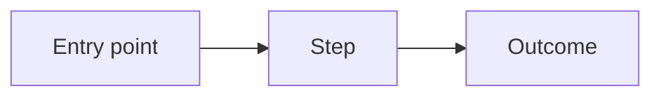

# <Feature name>

> **Summary.** Two or three sentences: what it does, who uses it, and the one thing a developer must know before changing it.

- **Status:** Live | Behind flag `<flag>` | In development | Deprecated
- **Apps:** mobile | web | both
- **Owner:** <team or person>
- **Last verified against code:** YYYY-MM-DD

## User journey

## Where the code is

| Layer | Path |
| --- | --- |
| Mobile screens | `apps/mobile/src/app/...` |
| Mobile services / hooks | `apps/mobile/src/services/...` |
| Web | `apps/web/...` |
| DB (tables, RLS, RPCs) | `supabase/migrations/<timestamp>_<name>.sql` |
| Edge Functions | `supabase/functions/<name>` |

## Data

Tables, columns and statuses this feature reads or writes, and the RLS rules that matter.

## Edge cases & gotchas

## Related

- ADRs: …
- Issues / PRs: …
