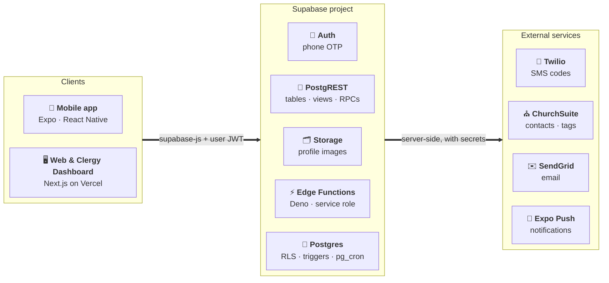
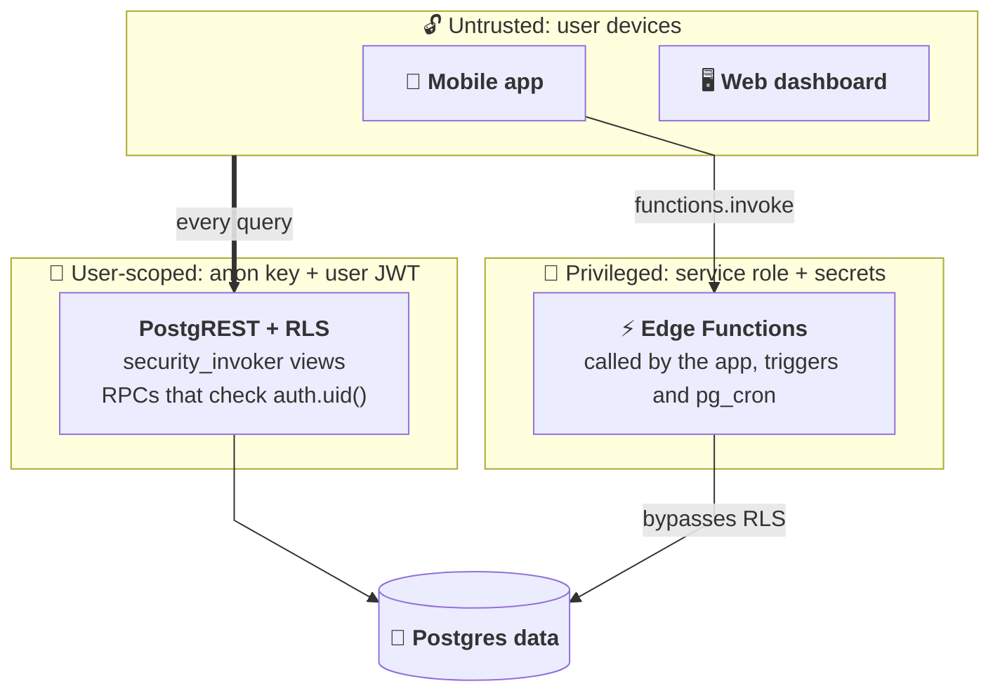

# System overview

> **Summary.** Two clients, an Expo mobile app and a Next.js web app, talk directly to one Supabase project using the user's session and row-level security (RLS). Anything that needs a secret or the service role runs in a Supabase Edge Function. Postgres triggers and `pg_cron` call Edge Functions for background work such as ChurchSuite sync, push notifications and reminders.

Last verified against code: 2026-11-22

## Tech stack diagram

Read it left to right: the clients only ever talk to Supabase, and only Supabase (Auth and the Edge Functions) talks to the outside world. Which function calls which service is in [integrations.md](./integrations.md). Not drawn, to keep the picture readable: Expo Push delivers notifications back to the mobile app, the website's contact form sends email through SendGrid (`/api/contact`), and both apps report errors to **Sentry**.

## Components

| Component | Tech | Code | Hosted on | Doc |
| --- | --- | --- | --- | --- |
| Mobile app | Expo 54, React Native 0.81, expo-router, TanStack Query, Zustand | `apps/mobile` | EAS Build → App Store / Play Store | [mobile.md](./mobile.md) |
| Web app & dashboard | Next.js 16 (App Router), React 19, Tailwind 4, Base UI, Recharts, MapLibre | `apps/web` | Vercel (root dir `apps/web`) | [web.md](./web.md) |
| Shared package | TypeScript types & constants | `packages/shared` | npm workspace | — |
| Database | Postgres with RLS, `security_invoker` views, RPCs, `pg_cron`, `pg_net` | `supabase/migrations` | Supabase | [backend.md](./backend.md) |
| Edge Functions | Deno | `supabase/functions` | Supabase | [backend.md](./backend.md#edge-functions) |
| Integrations | ChurchSuite, SendGrid, Twilio, Expo Push, Sentry, Vercel Analytics | various | third party | [integrations.md](./integrations.md) |
| Local mocks | Prism mock of the ChurchSuite OpenAPI spec, plus a Node mock server | `mocks/`, `docker-compose.yml` | local Docker | [integrations.md](./integrations.md#local-development) |

## Trust boundaries

Everything on a user's device is untrusted. Clients can only reach data through the RLS layer, as the signed-in user. The service role and third-party secrets exist only on the privileged side, which is why anything needing them is an Edge Function.

Rules that follow from this:

- Clients only ever hold the **anon key**. The service role key and third-party secrets (ChurchSuite, SendGrid) live in Edge Function secrets, with one exception: the website's contact form route (`apps/web/app/api/contact/route.ts`) reads `SUPABASE_SERVICE_ROLE_KEY` and `SENDGRID_API_KEY` on the Vercel server. Never put either in a `NEXT_PUBLIC_*` or `EXPO_PUBLIC_*` variable. See [security/access-and-secrets.md](../security/access-and-secrets.md).
- Cross-church isolation is enforced by **RLS**. New views must use `security_invoker = true`. See [ADR-0004](../decisions/0004-rls-and-security-invoker-views.md).
- Edge Functions that take a `church_id` must derive or check it against the caller's own profile, never trust the request body.

## Key flows

- [Sign up / sign in (phone OTP)](./backend.md#auth)
- [Join request → leader follow-up → reminder](./backend.md#join-request-lifecycle)
- [New user → ChurchSuite contact](./integrations.md#contact-sync-new-user--churchsuite-contact)
- [Daily vulnerable-tag reconciliation](./integrations.md#vulnerable-person-sync)
- [Push notifications](./integrations.md#push-notifications)

## Environments

| Environment | Database | Web | Mobile |
| --- | --- | --- | --- |
| Local | `supabase start` (project id `vineme2`), seeded from `supabase/seed.sql`, test OTPs in `config.toml` | `npm run dev:web` | `npm run dev:mobile` (dev client) |
| Preview | _TODO: document staging Supabase project, if any_ | Vercel preview deploys | EAS `preview` profile |
| Production | Supabase hosted project | Vercel production | EAS `production` profile → stores |

> Fill in the TODO rows when they're confirmed. Don't guess project refs or URLs.
