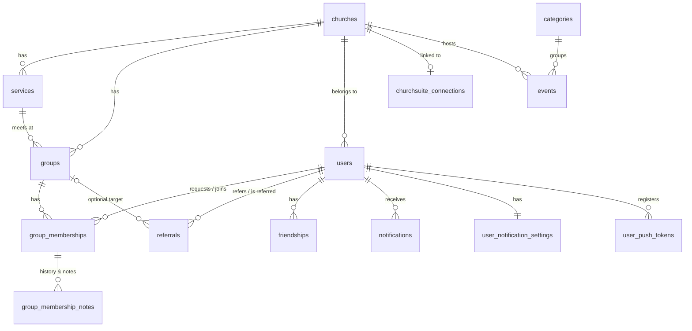
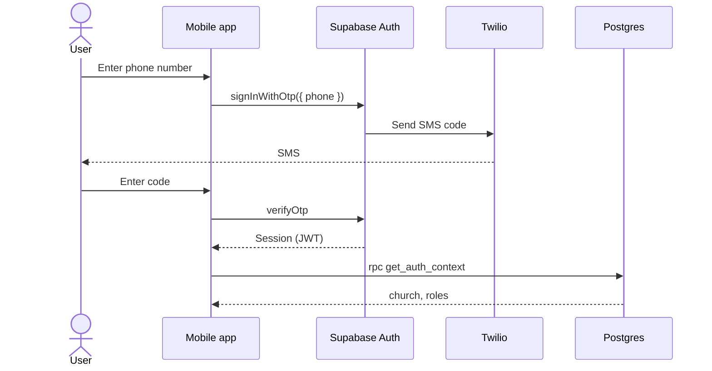
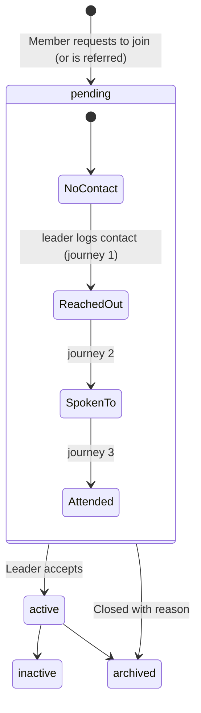

# Backend: Supabase

> **Summary.** One Supabase project serves both apps. Most reads and writes go straight from the client through PostgREST, protected by RLS. Privileged work (deleting auth users, creating referred users, anything with ChurchSuite or SendGrid secrets) runs in Edge Functions. Background jobs are `pg_cron` schedules and Postgres triggers that call Edge Functions over `pg_net`.

Last verified against code: 2026-11-21

## Layout

```text
supabase/
├── config.toml           # Local stack config, auth (Twilio SMS, test OTPs), per-function settings
├── migrations/           # The ONLY way schema, RLS, views, RPCs, triggers and cron change
├── migrations-archived/  # Superseded migrations. Never edit or re-run.
├── seed.sql              # Local seed data, loaded by `npm run db:reset`
└── functions/
    ├── _shared/          # Shared Deno modules (e.g. churchsuite.ts)
    └── <name>/index.ts   # One folder per Edge Function, with a deno.json import map
```

Generated types: `npm run db:types` writes to `packages/shared/src/database.types.ts`, consumed via `@vineme/shared`.

## Data model (core)

The ER diagram shows the main relationships only. The migrations are the source of truth.



Other tables: `new_church_requests`, `tickets`, `feature_flag` / `feature_flag_user_ids` (supaflag), and a separate `focus_festival` schema with its own views.

### Status columns worth knowing

| Table | Column | Values |
| --- | --- | --- |
| `users` | `roles` (`text[]`) | `user`, `church_admin`, `superadmin` |
| `group_memberships` | `role` | `member`, `leader`, `admin` (treated like a leader; none in use) |
| `group_memberships` | `status` | `pending` (a join request), `active`, `inactive`, `archived` |
| `group_memberships` | `journey_status` | `null`/0 no contact yet · 1 reached out · 2 spoken to · 3 attended |
| `groups` | `status` | `pending`, `approved`, `denied`, `closed` |
| `friendships` | `status` | `pending`, `accepted`, `rejected` |

Journey status changes are recorded in `group_membership_notes` with `note_type = 'journey_status_change'`. That table is the only record of *when* a request moved stage.

> The Clergy Dashboard defines its own words on top of these (connected, plugged in, needs help…). Use [apps/web/docs/dashboard/glossary.md](../../apps/web/docs/dashboard/glossary.md) for those, not this table.

## Access control

- **RLS everywhere.** Policies scope rows to the caller's church and role.
- **Views** use `security_invoker = true` so RLS applies as the caller. See [ADR-0004](../decisions/0004-rls-and-security-invoker-views.md).
- **RPCs** (`SECURITY DEFINER`) are used where a client needs a controlled, checked operation. The ones called from app code:

| RPC | Called from | Purpose |
| --- | --- | --- |
| `get_auth_context` | mobile | Resolve the signed-in user's church and roles |
| `get_user_contact_admin` | mobile, web | Admin-only read of a member's contact details |
| `app_create_notification` | mobile | Insert a notification for another user |
| `delete_my_account` | mobile | Self-service account deletion |
| `link_orphaned_user` | mobile | Re-link an auth user to a profile |
| `is_feature_flag_enabled` | mobile | supaflag feature flags (`useFeatureFlag`) |
| `link_service_to_churchsuite_site` | mobile admin | Map a service to a ChurchSuite site |
| `delete_churchsuite_connection` | mobile admin | Remove a church's ChurchSuite credentials |

To refresh this list: `grep -rhoE "\.rpc\(['\"][a-z_]+" apps --include='*.ts*' --exclude-dir=node_modules | sort -u`

## Auth

- **Mobile:** phone-first sign up / sign in with SMS OTP (`signInWithOtp` in `apps/mobile/src/services/auth.ts`), with email verification as a second factor. SMS goes through Twilio. Locally, fixed test OTPs are mapped in `supabase/config.toml`. See [ADR-0003](../decisions/0003-phone-first-authentication.md).
- **Web dashboard:** admin sign-in via `apps/web/components/auth/AdminLoginForm.tsx`, gated by `AdminGate`.
- **Dev only:** `dev-impersonate-user` lets developers sign in as any user without an OTP. It refuses to run only when `ENVIRONMENT` (or `APP_ENV`) is `production`, so every non-dev Supabase project must set that secret. See [environment setup](../guides/environment-setup.md#edge-functions).



## Edge Functions

| Function | Trigger / caller | Auth | External | What it does |
| --- | --- | --- | --- | --- |
| `create-referred-user` | mobile `services/referrals.ts` | user JWT | — | Creates an auth user and `public.users` profile for someone being referred |
| `delete-auth-user` | mobile `services/users.ts` | user JWT | — | Deletes from `auth.users` via the Admin API |
| `push-notify` (deployed as `push-notify-2`) | DB webhook on `notifications` insert; `group-leader-reminder-notifications` | service / self | Expo Push | Sends a push to all of a user's device tokens |
| `group-leader-reminder-notifications` | `pg_cron` job `group-leader-reminder-notifications` | secret key | — | Nudges leaders about pending requests (3 / 7 / 14 days by journey status) |
| `notify-missing-service` | _caller not found in app code; check before changing_ | — | SendGrid | Emails the team when a user's service is missing |
| `export-groups-csv` | mobile admin `ExportGroupsCsv.tsx` | church admin JWT | SendGrid | Exports groups and members as ChurchSuite import CSVs (download or email) |
| `create-churchsuite-connection` | mobile `admin/churchsuite.tsx` | church admin JWT | ChurchSuite | Stores credentials and provisions VineMe tags |
| `get-churchsuite-sites` | mobile `admin/churchsuite.tsx` | user JWT | ChurchSuite | Lists ChurchSuite sites for mapping to services |
| `list-churchsuite-vineme-contacts` | mobile `admin/churchsuite.tsx` | church admin JWT | ChurchSuite | Lists contacts VineMe created or matched |
| `create-churchsuite-contact` | Postgres trigger on `users` (church set, not yet linked) | webhook secret | ChurchSuite | Creates or matches a ChurchSuite contact and stores `churchsuite_id` |
| `mark-user-vulnerable` | church admin (_no caller in app code yet_) | church admin JWT | ChurchSuite | Sets `users.is_vulnerable` and applies the Vulnerable Person tag |
| `sync-churchsuite-vulnerable-tags` | `pg_cron` daily job, or a church admin | webhook secret or JWT | ChurchSuite | Reconciles `is_vulnerable` from ChurchSuite (ChurchSuite wins) |
| `dev-impersonate-user` | mobile devtools | none (env-gated) | — | Dev-only sign in as any user |

Per-function settings (`verify_jwt`, entrypoint, import map) live in `supabase/config.toml`. Each function's header comment is the detailed reference. Keep it up to date. How-to: [guides/edge-functions.md](../guides/edge-functions.md).

## Background jobs

| Job | Mechanism | Schedule | Calls |
| --- | --- | --- | --- |
| `sync-churchsuite-vulnerable-tags-daily` | `pg_cron` → `trigger_sync_all_churchsuite_vulnerable_tags()` → `pg_net` | Read from Vault secret (re-apply with `reschedule_churchsuite_vulnerable_tags_sync()`) | `sync-churchsuite-vulnerable-tags` |
| `group-leader-reminder-notifications` | `pg_cron` → `trigger_group_leader_reminder_notifications()` → `pg_net` | Read from Vault secret | `group-leader-reminder-notifications` |
| ChurchSuite contact sync | `AFTER INSERT/UPDATE OF church_id ON users` trigger | on change | `create-churchsuite-contact` |
| Push on new notification | Database webhook on `notifications` insert (commented out in the initial migration, so it's configured in the Supabase dashboard; confirm it there) | on insert | `push-notify-2` |
| Default notification settings | `AFTER INSERT ON users` trigger | on insert | SQL only |

Local helpers: `npm run cron:status`, `npm run cron:disable`, `npm run cron:enable`.

## Join request lifecycle



Reminders: `group-leader-reminder-notifications` nudges the leader when a request has sat at a stage for longer than 3 days (no contact), 7 days (reached out) or 14 days (spoken to). The thresholds are hard-coded constants for now.
