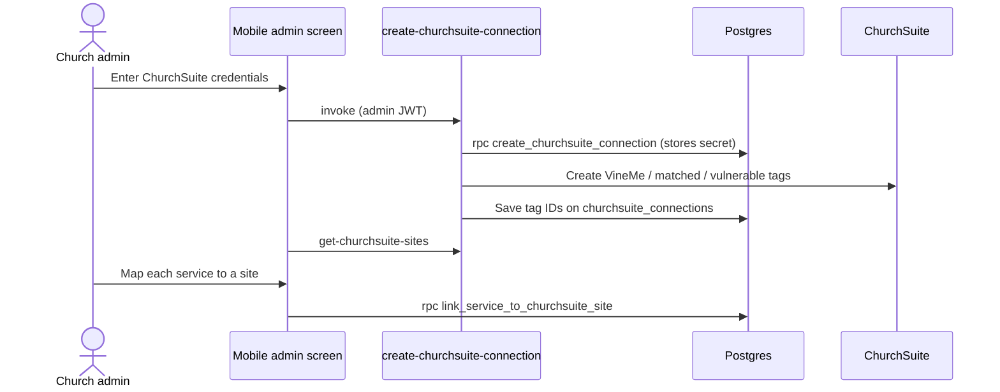
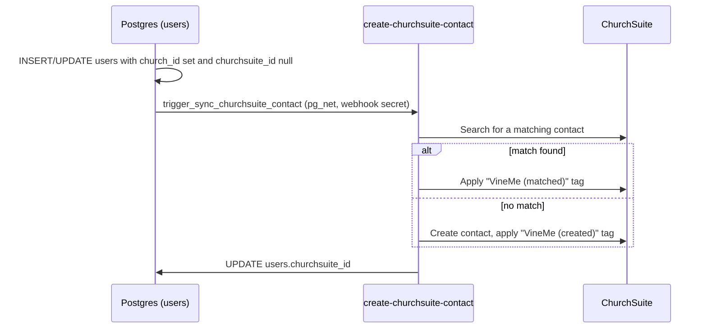
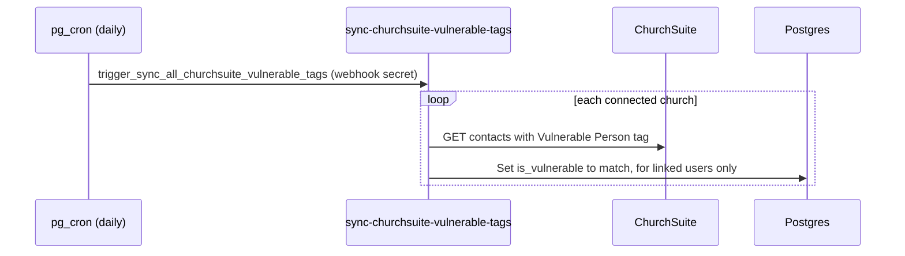
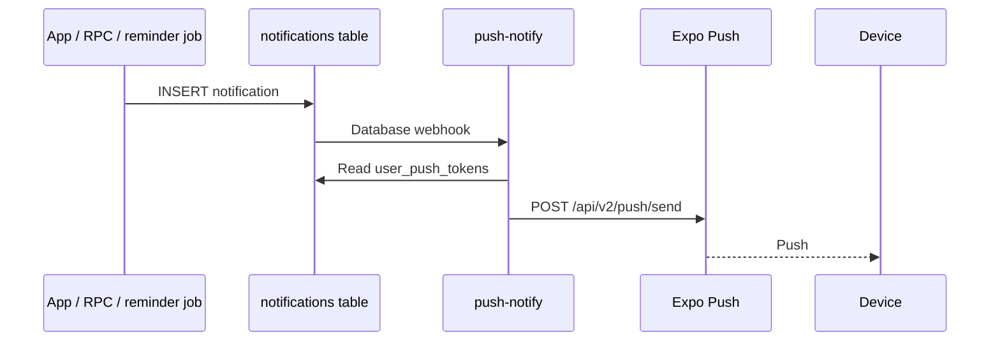

# External integrations

> **Summary.** Every third-party call that needs a secret goes through an Edge Function. ChurchSuite is the biggest integration: VineMe creates or matches a ChurchSuite contact for each user, tags it, and treats ChurchSuite as the source of truth for the "Vulnerable Person" flag.

Last verified against code: 2026-11-22

Every variable, and where to set it per environment: [guides/environment-setup.md](../guides/environment-setup.md).

| Service | Used for | Called from | Secrets / env |
| --- | --- | --- | --- |
| **ChurchSuite** | Contact sync, tags, sites | Edge Functions + `_shared/churchsuite.ts` | `CHURCHSUITE_API_URL`, `CHURCHSUITE_AUTH_API_URL`, `CHURCHSUITE_WEBHOOK_SECRET`; per-church credentials in `churchsuite_connections` (secret stored securely, read via RPC) |
| **SendGrid** | Transactional email | `export-groups-csv`, `notify-missing-service`, web `app/api/contact/route.ts` | `SENDGRID_API_KEY`, `EXPORT_FROM_EMAIL`, `MISSING_SERVICE_FROM_EMAIL`, `MISSING_SERVICE_TO_EMAIL` |
| **Twilio** | SMS OTP | Supabase Auth (config) | Supabase Auth settings |
| **Expo Push** | Push notifications | `push-notify` | none (Expo push tokens in `user_push_tokens`) |
| **Sentry** | Error monitoring | mobile (`@sentry/react-native`), web (`@sentry/nextjs`) | DSN in app config |
| **Vercel Analytics** | Web analytics | `apps/web` | — |
| **Google Maps** | Maps in the mobile app | mobile (`react-native-maps`, config plugin) | `EXPO_PUBLIC_GOOGLE_MAPS_API_KEY` (public, restrict by app ID) |
| **Mapbox** | Address and place search | mobile `services/location.ts` | `EXPO_PUBLIC_MAPBOX_TOKEN` (optional, public token) |
| **Metabase** | Legacy reporting; being retired in favour of the dashboard | external | — |

## ChurchSuite

Tags provisioned per church by `create-churchsuite-connection`:

- **VineMe (created):** VineMe created a new contact.
- **VineMe (matched):** VineMe linked to an existing contact.
- **Vulnerable Person:** applied manually by admins in ChurchSuite, or by `mark-user-vulnerable`.

### Connecting a church

### Contact sync (new user → ChurchSuite contact)

Note: `create-churchsuite-contact` has a **temporary rollout gate** that limits it to internal `@vineme.app` accounts, so the contact sync **isn't live for churches yet**. The gate is staying for now. Scope and open questions: [features/churchsuite](../features/churchsuite/README.md).

The sync covers contacts and tags only. Group membership stays in VineMe ([ADR-0008](../decisions/0008-churchsuite-contacts-only.md)).

### Vulnerable Person sync

ChurchSuite is the source of truth here. See [ADR-0005](../decisions/0005-churchsuite-source-of-truth-for-vulnerable-flag.md).

## Push notifications

## Local development

`docker-compose.yml` runs:

- `churchsuite`: a Prism mock of ChurchSuite's OpenAPI spec on `localhost:8030`.
- `mocks`: a Node mock server (`mocks/`) on `localhost:8029`.

Both join the `supabase_network_vineme2` Docker network, so local Edge Functions can reach them. Point `CHURCHSUITE_API_URL` at the mock when running functions locally.

## Future integrations

- **Planning Center:** may be needed, as some churches are moving to it from ChurchSuite. Not started. VineMe keeping its own database ([ADR-0007](../decisions/0007-keep-own-database.md)) is what makes a second church management system possible.
