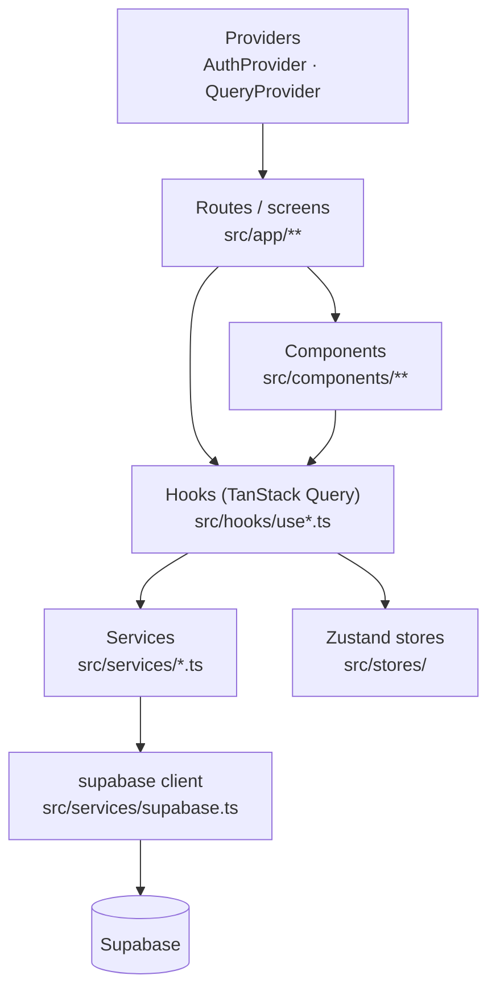

# Mobile app (`apps/mobile`)

> **Summary.** An Expo / React Native app with file-based routing (expo-router). Screens call hooks, hooks call services, and services call Supabase. Server state lives in TanStack Query. Zustand holds a small amount of client state (auth, group filters).

Last verified against code: 2026-11-21

## Layering

**Rule of thumb:** screens never call `supabase` directly. Add a service function and wrap it in a hook.

## Routes (`src/app`)

| Route group | Purpose |
| --- | --- |
| `(auth)/` | Welcome, phone sign up / login, OTP verify, email verify, onboarding |
| `(tabs)/` | Home, Groups, Events, Profile |
| `group/[id]`, `group/create`, `group-management/[groupId]` | Group detail, creation, leader management |
| `event/[id]`, `user/[id]`, `friends`, `notifications` | Detail screens |
| `referral`, `referral-landing` | Referral flow and deep-link landing |
| `admin/` | Church admin tools: join requests, groups, users, notifications, ChurchSuite |
| `styling-system-*` | Dev demos of the theme system |

## Key modules

| Area | Where | Notes |
| --- | --- | --- |
| Auth | `services/auth.ts`, `providers/AuthProvider.tsx`, `stores/auth.ts` | Phone OTP; see [backend.md#auth](./backend.md#auth) |
| Permissions | `services/permissions.ts`, `hooks/usePermissions.ts` | Role checks for admin / leader UI |
| Groups & join requests | `services/groups.ts`, `services/joinRequests.ts`, `hooks/useGroups.ts`, `hooks/useJoinRequests.ts` | |
| Referrals | `services/referrals.ts`, `services/referralDatabase.ts` | Calls `create-referred-user`. See [features/referrals](../features/referrals/README.md) |
| Notifications | `services/notifications.ts`, `hooks/useNotifications.ts` | Expo push token registration |
| Feature flags | `hooks/useFeatureFlag.ts` | supaflag RPC |
| Theme / UI | `src/theme/`, `src/components/ui/` | Own READMEs: [theme](../../apps/mobile/src/theme/README.md), [ui](../../apps/mobile/src/components/ui/README.md) |
| Errors | `utils/globalErrorHandler.ts`, Sentry in `app/_layout.tsx` | |

## Builds

EAS profiles in `apps/mobile/eas.json`: `development` (dev client, internal), `preview` (internal), `production` (store, auto-increment). App config: `app.config.ts`. Universal / App Links: [guides/universal-links.md](../guides/universal-links.md).

## Tests

Jest, split by path: unit (`services|hooks|utils|components|stores|providers`), `src/__tests__/integration`, `src/__tests__/e2e`. See [guides/testing](../guides/testing/README.md).
