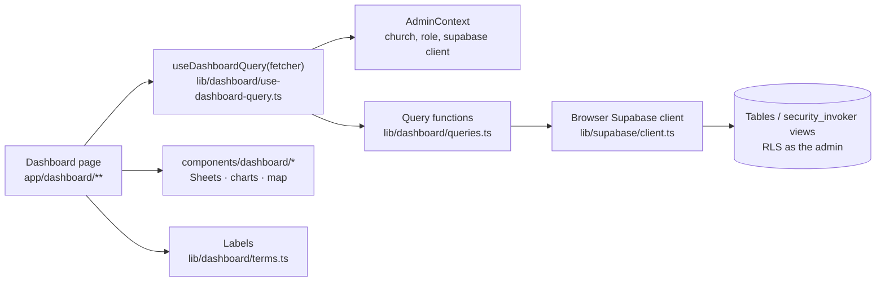

# Web app & Clergy Dashboard (`apps/web`)

> **Summary.** A Next.js 16 App Router site on Vercel. It serves the public website (church finder, legal pages, contact form) and the Clergy Dashboard at `/dashboard`. Dashboard pages are client components that query Supabase with the browser client as the signed-in admin, so RLS applies.

Last verified against code: 2026-11-22

> ⚠️ Next.js 16 has breaking changes. Read `apps/web/AGENTS.md` and `node_modules/next/dist/docs/` before writing web code.

## Routes (`app/`)

| Route | Purpose |
| --- | --- |
| `/` | Marketing site |
| `/find`, `/church` | Find a church or group (MapLibre maps, `maplibre-worker/`) |
| `/legal/*` | Church terms, end-user terms, privacy policy |
| `/login`, `/reset` | Admin sign-in and password reset |
| `/dashboard` | Overview, `follow-ups`, `groups`, `members`, `reports` (Insights), `settings`, `profile` |
| `/api/contact` | Server route that sends contact-form email through SendGrid |
| `/.well-known/*` | Universal / App Link host files (`public/.well-known`) |

## Dashboard data flow

Rules (from `apps/web/AGENTS.md`):

- Use the words in [apps/web/docs/dashboard/glossary.md](../../apps/web/docs/dashboard/glossary.md) exactly. UI labels come from `lib/dashboard/terms.ts`.
- Numbers come from the request and person views, never from new calculations in components.
- Reuse the shared contact block, avatar and drawers (`*Sheet.tsx`).
- Design system: [apps/web/app/dashboard/DESIGN.md](../../apps/web/app/dashboard/DESIGN.md).

## Deployment

Vercel project with root directory `apps/web` and ignored build step `git diff HEAD^ HEAD --quiet -- . ../../packages/shared`. Env vars: see [guides/environment-setup.md](../guides/environment-setup.md#web-app). The contact form (`/api/contact`) uses server-only secrets. Sentry is configured in `sentry.*.config.ts` and `instrumentation*.ts`.
