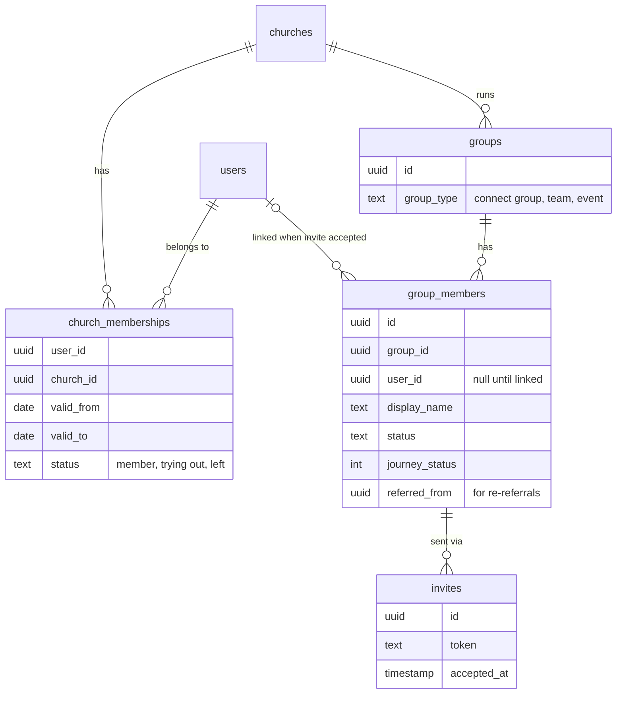

# ADR-0010: Only create a user account when someone signs up themselves

- **Status:** Proposed (suggested by Aonghas at the 21 Nov 2026 kickoff; **not agreed**, open for discussion)
- **Date:** 2026-11-21
- **Scope:** db, mobile, privacy
- **Related:** [features/referrals](../features/referrals/README.md), [architecture/backend.md](../architecture/backend.md#data-model-core), [security/data-protection.md](../security/data-protection.md)

## Context

Today a referral creates a full account for the referred person. `create-referred-user`:

1. creates a Supabase **auth** user and sends an invite email (`inviteUserByEmail`);
2. inserts a `public.users` row with the referrer's `church_id` and `service_id`.

Setting `church_id` fires the `trigger_sync_churchsuite_contact` trigger, so once the ChurchSuite rollout gate is lifted, a referred person would be pushed into ChurchSuite before they have agreed to anything. Leader-added people would raise the same issue.

Related needs that the current model can't meet:

- **Re-referral:** a stuck request can only be archived. A new request for a different group should be linked to the old one.
- **Multi-church users:** each user has exactly one `users.church_id`.
- **Group types:** `groups` has no type column, so teams, hobby groups, courses and events can't be told apart.

## Proposal

A `users` row exists only for someone who signed up themselves. Everyone else is a group member record, linked to a user if and when they accept an invite. The same linking pattern later supports one person in several churches.

Column lists are partial, from the kickoff draft. Olly and Tom to correct them against the schema.

## Options considered

| Option | Pros | Cons |
| --- | --- | --- |
| Keep creating full accounts for referred people (today) | No migration | Accounts and ChurchSuite contacts for people who haven't consented. No re-referral link. One church per user |
| Separate member records, linked on invite (proposed) | Consent before an account exists. Supports re-referral, multi-church and proxy members | Large migration across `group_memberships`, RLS, the dashboard views and the mobile app |
| Minimal: add `referred_from` to `group_memberships` only | Small change that unlocks re-referral | Doesn't fix the consent problem |

## Open questions

- Should referred people be pushed to ChurchSuite before they accept? (Left open at the kickoff.)
- Is re-referral done by adding a new `group_memberships` row for the new group, so the new leader is notified and owns it?
- Should `church_memberships` come now, or wait until a second church needs it?

## Consequences if accepted

- Every dashboard view built on `group_memberships` (the dashboard glossary's request and person views) has to change.
- Needs its own migration plan and RLS review (ADR-0004).
