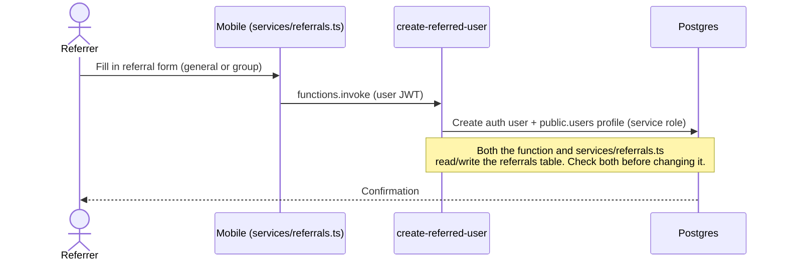

# Referrals

> **Summary.** A member can refer someone else, either generally ("no specific group fits") or to a specific group. The mobile app calls the `create-referred-user` Edge Function, which creates the referred person's auth user and profile with the service role, and the referral is recorded in `referrals`.

- **Status:** Live
- **Apps:** mobile
- **Last verified against code:** _TODO: verify the three docs below against the code, then set this date_

## Where the code is

| Layer | Path |
| --- | --- |
| Screens | `apps/mobile/src/app/referral.tsx`, `apps/mobile/src/app/referral-landing.tsx` |
| Components | `apps/mobile/src/components/referrals/` (has its own README) |
| Services / hooks | `apps/mobile/src/services/referrals.ts`, `apps/mobile/src/services/referralDatabase.ts`, `apps/mobile/src/hooks/useReferrals.ts` |
| Edge Function | `supabase/functions/create-referred-user` |

## What a referral creates

`create-referred-user` does more than add a row:

1. creates a Supabase **auth** user for the referred person and sends them an invite email (`inviteUserByEmail`);
2. inserts a `public.users` row with the referrer's `church_id` and `service_id`, and `newcomer` set;
3. because `church_id` is set, the `trigger_sync_churchsuite_contact` trigger fires. The ChurchSuite rollout gate stops this reaching ChurchSuite today, but it wouldn't once the gate is lifted.

The referred person hasn't agreed to any of this yet. See [security/data-protection.md](../../security/data-protection.md).

## Open questions

- **Proxy members:** store referred and leader-added people separately from `users`, and link them to a real user when they accept an invite? Proposed in [ADR-0010](../../decisions/0010-separate-group-members-from-user-accounts.md), not agreed.
- **ChurchSuite:** should referred people be pushed to ChurchSuite before they accept? Left open.
- **Re-referral:** see [groups & join requests](../groups-and-join-requests/README.md#not-built-yet).

## Detailed docs (2025, not yet re-verified)

- [user-guide.md](./user-guide.md): end-user walkthrough
- [api.md](./api.md): service methods
- [database.md](./database.md): `referrals` table and operations

History: [archive/2025-referral-testing-summary.md](../../archive/2025-referral-testing-summary.md), original spec in [archive/2025-kiro-specs/referral-system/](../../archive/2025-kiro-specs/referral-system/).
