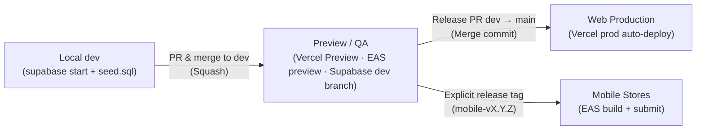

# Deployment and releases

> **Summary.** How code, database migrations, and Edge Functions move safely from local development through Preview QA to Production across Next.js (Vercel), Expo (EAS), and Supabase.

---

## 1. Environments at a glance

Even though both apps share one `dev` branch, **code integration is decoupled from user releases**. The flow below summarises where each app and database environment builds and ships:

| Layer | Local | Preview / Dev (`dev` & PRs) | Production (`main` / Store Releases) |
| :--- | :--- | :--- | :--- |
| **Web (`apps/web`)** | `npm run dev:web` (`apps/web/.env.local`) | Vercel Preview deployments (auto on PRs and `dev`) | Vercel Production deployment (auto when `dev` merges into `main`) |
| **Mobile (`apps/mobile`)** | `npm run dev:mobile` / EAS `development` profile (`com.pilotlight.vineme.dev`) | EAS `preview` profile (internal APK / IPA) | EAS `production` profile (`autoIncrement`) submitted via `eas submit` (`submit-ios.yaml`) |
| **Database & Edge Functions (`supabase/`)** | Local Supabase CLI (`supabase start`, `npm run db:reset`, `supabase/seed.sql`) | Supabase GitHub Branching (persistent `dev` branch + PR preview branches) | Supabase Production project (applied when `dev` merges to `main`) |

Env var locations per environment: [environment-setup.md](./environment-setup.md).

---

## 2. Keeping Preview & QA safe

> [!WARNING]
> **Never leave Vercel Preview (`dev`) pointing at the Production Supabase database.** Testing an in-progress PR or QA'ing `Ready for QA` issues against Production exposes real church member personal data and prevents testing SQL migrations safely before release.

**Current target setup (Supabase GitHub Branching):**

- Supabase GitHub Branching is connected to `VineMe-App/vineme2.0` (automatically provisioning preview database branches on PRs and maintaining a persistent `dev` database branch with seeded data).
- In **Vercel → Project Settings → Environment Variables**, configure **Preview** (`NEXT_PUBLIC_SUPABASE_URL`, `NEXT_PUBLIC_SUPABASE_ANON_KEY`, and Preview `SUPABASE_SERVICE_ROLE_KEY`) to point to the **Supabase `dev` branch**, leaving Production Supabase credentials strictly under Vercel **Production**.
- **Future cost-optimisation option:** To reduce hosted branching costs later, swap Vercel Preview env vars and EAS `preview` builds to a dedicated **free-tier Staging Supabase project** and run `supabase db push` / `supabase functions deploy` from GitHub Actions on merges to `dev` (and on `main` for Production).

---

## 3. Deploying Web (`apps/web`)

1. **Pull Requests & `dev`:** Every PR and merge to `dev` builds a **Vercel Preview URL**. Authors of Tier 2 (`risk:medium`) PRs verify UI changes on the Preview URL before merging to `dev`.
2. **Release to Production (`dev` → `main`):**
   - Open a release PR from `dev` into `main` (always use **Create a merge commit** so `dev` and `main` never diverge).
   - Ensure `test (20.x)`, `supabase-gate`, and **1 approving review** (from a Code Owner if any `CODEOWNERS` paths changed) pass.
   - Vercel automatically builds and promotes `apps/web` to production on merge, using its Ignored Build Step (`git diff HEAD^ HEAD --quiet -- . ../../packages/shared`) so mobile-only commits skip unnecessary web builds.
3. **Post-release:** Confirm no new spikes appear in `#sentry-alerts` (`vineme-web`), then move verified `Ready for QA` issues on `VineMe 3.0` to `Done`.

---

## 4. Deploying Mobile (`apps/mobile`)

Merging into `main` does **not** trigger App Store, Play Store, or OTA builds—mobile releases happen deliberately from verified commits:

- **EAS profiles (`apps/mobile/eas.json`, project `@tonaeko/vineme-mobile-app`):**
  - `development` — Dev client APK / device build with `APP_VARIANT=development` (`com.pilotlight.vineme.dev`, coexists alongside the live store app on the same phone).
  - `preview` — Internal distribution APK / ad-hoc iOS build for team QA before release.
  - `production` — Store distribution (`distribution: "store"`, `autoIncrement: true`), submitted via `eas submit` (with `submit-ios.yaml` workflow on EAS).
- **Feature gating:** Wrap incomplete mobile screens or API calls in **`supaflag`** (`useFeatureFlag` — `hooks/useFeatureFlag.ts`) so `dev` and `main` remain shippable at any time.
- **Release tagging & hotfix rule:**
  - Tag each shipped store build cleanly (for example `git tag mobile-v2.0.4 && git push origin mobile-v2.0.4`).
  - If an urgent store-review patch is needed while `dev` has moved ahead, branch short-lived `release/mobile-x.y.z` from that tag, submit the build, and cherry-pick/merge the fix into `dev`.

---

## 5. Deploying Database Migrations & Edge Functions (`supabase/`)

1. **Author & lint locally:**
   - Generate migrations via `npm run db:migration:new <descriptive_snake_case_name>`, verify from scratch with `npm run db:reset`, and regenerate types with `npm run db:types`.
   - Follow **Expand → Migrate → Contract** ([CONTRIBUTING.md](../../CONTRIBUTING.md#independent-web--mobile-releases-why-one-shared-dev-branch)) so older live mobile builds keep working across app-store rollout windows: add new tables, views (`WITH (security_invoker = true)`), or nullable/defaulted columns first; only drop or rename live objects once older mobile builds are retired.
   - Run `node scripts/check-migration-compat.mjs <migration-file>` locally; CI (`supabase-gate`) runs this automatically before `supabase start`. Intentional Contract-phase cleanups require `-- allow-breaking-migration: <reason>` (at least 10 characters).
2. **Apply to `dev` & `main`:**
   - Supabase GitHub Branching applies tracked migrations and Edge Functions on PR preview branches, merges to `dev`, and releases to `main`.
   - Detailed SQL & Edge Function checklists: [database-migrations.md](./database-migrations.md) and [edge-functions.md](./edge-functions.md).
