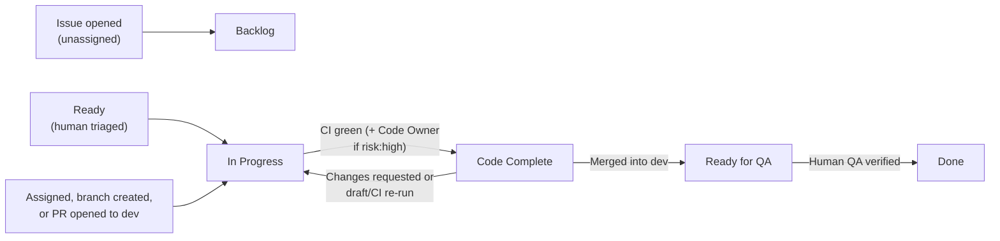

# Team workflow

> **Summary.** How the VineMe team files issues, plans releases on the `VineMe 3.0` project board, automates issue triage, uses Slack and Sentry together, and works safely with AI coding agents.

---

## 1. Filing and scoping issues

All issues across mobile, website, Clergy Dashboard, and Supabase live in `VineMe-App/vineme2.0`. Blank issues are disabled (`.github/ISSUE_TEMPLATE/config.yml`), so pick one of the three structured forms:

| Form | Template | Auto-label | When to use |
| :--- | :--- | :--- | :--- |
| **Feature / Spec** | `.github/ISSUE_TEMPLATE/feature-spec.yml` | `enhancement` | New behaviour or a scoped implementation task with testable EARS acceptance criteria (`WHEN ... THEN ... SHALL ...`), doc/ADR links, non-goals, and data/RLS impact |
| **Bug Report** | `.github/ISSUE_TEMPLATE/bug-report.yml` | `bug` | Broken behaviour with reproduction steps, expected vs actual output, role/environment context, and fix criteria (never paste real personal data) |
| **Decision Needed** | `.github/ISSUE_TEMPLATE/decision-needed.yml` | `decision` | Any unresolved product, schema, glossary, or privacy ambiguity blocking work |

**Working rules:**

- **One logical issue per PR:** Keep unrelated clean-ups in separate issues rather than bundling them into an active branch.
- **Stop on open decisions:** If an item relies on an open choice (such as a **"Decision needed"** marker in `apps/web/docs/dashboard/glossary.md`), file or link a *Decision Needed* issue instead of guessing.
- **Slack issue creation:** Built-in Slack `/github open` bypasses GitHub's structured YAML forms, so issue creation happens directly on GitHub rather than from Slack for now.

### Labels overview

- **Issue type:** `enhancement`, `bug`, `decision`, `question`, `wontfix`
- **Triage & sizing:** `good first issue`, `urgent`, `size:S` (<1h), `size:M` (2–3h), `size:L` (>1 session)
- **Area & epic tags:** Monorepo/dashboard areas (`dashboard`, `needs-dev`, `data`, `overview`, `follow-ups`, `groups`, `members`, `insights`, `settings`, `shared`, `design`) and existing mobile epics (`Onboarding`, `Home Page`, `Group Explorer`, `Group Management`, `Friends`, `Newcomers`, `Notifications`, `Permissions`, `Analytics`, `Profile`, `UI/UX`)
- **Automation (bot-managed):** `risk:low`, `risk:medium`, `risk:high`, `eas-build`, `codex`

---

## 2. Planning with VineMe 3.0 and Milestones

Rather than splitting separate project boards per feature or app, the team shares **one living Organization-level GitHub Project (`VineMe 3.0`)** under `VineMe-App`:

- **Status columns (`Status` field):** `Backlog` → `Ready` → `In Progress` → `Code Complete` → `Ready for QA` → `Done`
- **Recommended Saved Views on `VineMe 3.0`:**
  - **Board:** Kanban grouped by `Status` for daily stand-ups and sprint flow
  - **Dashboard:** Filtered to `dashboard` / web issues
  - **Mobile:** Filtered to `apps/mobile` / mobile epic labels
  - **QA Queue:** Filtered to `Status = Ready for QA` for testing against Preview builds before shipping to `main`
  - **Decisions Needed:** Filtered to `label = decision` to unblock stalled engineering work
  - **Roadmap:** Grouped by **Milestone**
- **Milestones:** Use repository milestones for concrete phases and releases (for example `1. Decide and audit` through `5. Polish`, `V2 release`, or release-scoped milestones) rather than a permanent catch-all backlog.

---

## 3. Automated issue triage

The diagram below shows how GitHub events automatically move an issue across `VineMe 3.0` via [`.github/workflows/project-triage.yml`](../../.github/workflows/project-triage.yml) and [`scripts/project-triage.mjs`](../../scripts/project-triage.mjs):

| Transition | Trigger evaluated by `scripts/project-triage.mjs` | Guardrails |
| :--- | :--- | :--- |
| **→ `Backlog`** | Issue opened with no assignee | Skipped if issue already has a board status |
| **→ `In Progress`** | Issue opened with an assignee or assigned later; matching branch created (`feat\|fix\|chore\|docs\|refactor/<issue>-*`); draft or open PR targeting `dev` awaiting checks/review; changes requested (`CHANGES_REQUESTED`) | Never pulls an issue back from `Ready for QA` or `Done`; assignment alone never pulls back `Code Complete` |
| **→ `Code Complete`** | Non-draft PR targeting `dev` where required checks (`test (20.x)` and `supabase-gate`) both pass, no reviewer has `CHANGES_REQUESTED`, and (if `risk:high`) a non-author Code Owner in [`.github/CODEOWNERS`](../../.github/CODEOWNERS) has `APPROVED` | Pulls back to `In Progress` if switched to draft, changes are requested, or a new push resets checks |
| **→ `Ready for QA`** | Linked PR (`Closes #<n>` or branch `<type>/<n>-...`) is merged into `dev` | Never moves an issue already in `Done`; release PRs targeting `main` are ignored |
| **→ `Done`** | **Manual** move after verifying on Vercel Preview (`dev`) / Expo `preview` | — |

### One-time `VineMe 3.0` setup checklist

For the workflow to update the Org-level project automatically:

1. **Add repo secret `PROJECT_AUTOMATION_TOKEN`:** Create a token (or GitHub App secret) with **Organization Projects (Read & Write)** and **Repository (Read)** access, then save it under **Settings → Secrets and variables → Actions → Repository secrets**. (Until set, the workflow logs a skip message and exits `0`.)
2. **Confirm exact Status option names on `VineMe 3.0`:** Ensure the `Status` single-select field includes `Backlog`, `Ready`, `In Progress`, `Code Complete`, `Ready for QA`, and `Done`.
3. **Disable GitHub's built-in `Item closed → Done` workflow on `VineMe 3.0`:** Because `dev` is the default branch, merging `Closes #<n>` closes the issue immediately; disabling that built-in rule prevents GitHub from jumping the card past `Ready for QA`.

---

## 4. Slack, GitHub and Sentry

We use free native integrations across four channels in `vineme.slack.com` to keep noise low:

| Channel | Purpose | Integration & Team Habit |
| :--- | :--- | :--- |
| **`#tech`** | Architecture, engineering chat, release heads-up, blocking decisions | Humans announce `dev → main` / mobile releases and escalate `decision` issues (no automated issue spam) |
| **`#dev-prs`** | Pull request lifecycle & review pings | Subscribed via `/github subscribe VineMe-App/vineme2.0 pulls reviews` (intentionally omits issue-open/comment chatter) |
| **`#sentry-alerts`** | Error tracking (`vineme-mobile` and `vineme-web`) | Automated Sentry alerts; **3-step triage:** (1) react with 👀 when investigating, (2) file a *Bug Report* referencing the Sentry short ID without personal data, (3) react with ✅ once linked or resolved |
| **`#product-strategy` & `#design`** | Product direction, UX feedback, design handoff | Cross-post `decision` issues and screenshots when product or design input is needed |

---

## 5. Working with AI coding agents

Context and guardrails live in the repository so every developer's agent shares the same rules:

- **Instruction hierarchy:** Root [`AGENTS.md`](../../AGENTS.md) plus scoped guides (`apps/mobile/AGENTS.md`, `apps/web/AGENTS.md`, `supabase/AGENTS.md`). Each `CLAUDE.md` imports its matching `AGENTS.md`.
- **Reusable skills (`.agents/skills/`, symlinked at `.claude/skills/`):**
  - `write-spec` — Turn a feature idea or issue into a testable specification
  - `implement-issue` — End-to-end issue flow from `dev` branch through PR and verification
  - `supabase-migration` — Safe SQL migrations (`security_invoker`, RLS, backward compatibility, `db:types`)
  - `pre-pr-verify` — Scoped lint, typecheck, test, build, and migration checks before committing
  - `church-data-protection` — UK GDPR and safeguarding checks for personal data changes
  - `security-audit` — Security review checklist (findings stay out of tracked files and public PRs)
- **Automated PR reviews:** Codex (`chatgpt-codex-connector`) reviews PRs automatically on open and on `@codex review` comments. See [CONTRIBUTING.md](../../CONTRIBUTING.md) for the full branching, risk-tier PR, and merge rules.
