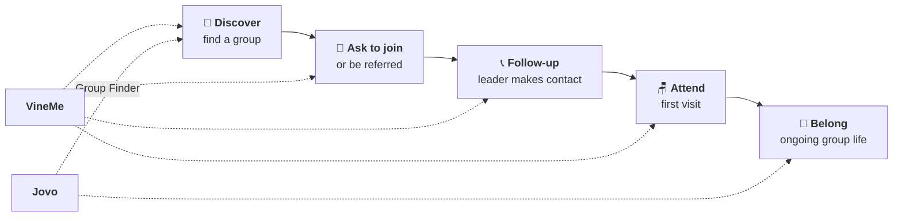

# VineMe vs Jovo

> **Summary.** Jovo is a church **messaging** app: it gives existing teams and groups a safeguarded place to talk, replacing WhatsApp. VineMe is a church **connection** app: it helps people find a group, ask to join, and get followed up until they belong, and shows clergy who is falling through the gaps. They overlap at the edges (a group finder, ChurchSuite integration, events), but their core jobs are different. The sharpest overlap is that VineMe hands group chat off to a WhatsApp link, which is exactly what Jovo sells against.

- **Researched:** 2026-11-21, from Jovo's own website and one UK review listing (sources below). Jovo's features weren't tested hands-on.
- **VineMe facts:** from this repo, verified against code on the same date.
- **Treat Jovo's claims as vendor claims.** Its prices and limits differ between its own pages and the review site, so check before quoting them to anyone.

## At a glance

| | **VineMe** | **Jovo** |
| --- | --- | --- |
| **Core job** | Get people *into* groups and keep track of them until they belong | Give teams and groups a safe place to *talk* |
| **Main users** | Members, group leaders, clergy and church admins | Staff, volunteers, small groups, youth and event teams |
| **Question it answers for clergy** | "Who's asked to join, who's been followed up, and who's slipping through?" | "Are our groups communicating safely, off WhatsApp?" |
| **Group chat** | ❌ None in-app. Each group has an optional `whatsapp_link` | ✅ Chat groups, one-way news groups, multi-groups, polls, scheduled posts |
| **Group discovery** | ✅ List and map, filters, group detail pages | ✅ "Group Finder" and a discoverable organisation |
| **Request to join + leader approval** | ✅ Join requests, with leader approve or decline | ⚠️ Not described. Open groups can be joined directly, and leaders control who can join |
| **Newcomer follow-up** | ✅ Journey stages (no contact → reached out → spoken to → attended) and automatic leader reminders after 3, 7 or 14 days | ❌ Not described. The review says it isn't a pastoral-care system |
| **Referrals** | ✅ Members can refer a friend generally or to a specific group | ❌ Not described |
| **Clergy dashboard** | ✅ Follow-ups, Members, Groups and Insights (how people are getting connected) | ⚠️ Admin "Insights": activity and engagement stats only |
| **ChurchSuite** | ✅ Creates or matches a contact per member, applies VineMe tags, syncs the Vulnerable Person flag daily, exports groups as CSV | ✅ Syncs groups and invites, and can invite people by ChurchSuite tag |
| **Planning Center** | ❌ | ✅ |
| **Events** | ⚠️ Events screen exists but is hidden from the tab bar (`href: null` in `app/(tabs)/_layout.tsx`) | ✅ Dated posts also appear in an Events tab |
| **Push notifications** | ✅ Expo push for requests, approvals, referrals and reminders | ✅ Plus quiet hours and email digests of unread messages |
| **Sign-in** | Phone number + SMS code, with email verification | Name and email ("No personal numbers") |
| **Platforms** | iOS and Android app; web dashboard for clergy | iOS, Android and web |
| **Pricing** | _TODO: confirm VineMe's pricing model_ | From £49/month (Lite, up to 100 users); £110/month (Jovo); custom (Plus); 30-day free trial. See [Pricing](#jovo-pricing) |

## Where each one fits in a member's journey

The diagram shows the path from someone hearing about a church to belonging in a group, and which product covers each step. VineMe covers the path into a group. Jovo covers life inside one.

## Safeguarding compared

Both products take safeguarding seriously, but in different places.

| Concern | **VineMe** | **Jovo** |
| --- | --- | --- |
| Personal contact details | Shared with group leaders when someone requests to join; the app warns first ([ADR-0006](../decisions/0006-join-requests-share-contact-details-by-notice.md)) | Members join with a name and email only, and phone numbers aren't shared |
| Private / direct messages | None. Conversations happen off-app, usually in WhatsApp | "There are no private messages in Jovo" |
| Audit trail | Stage changes and notes per join request (`group_membership_notes`) | "Safeguarding Logs" of edits, deletions, who made them and which group |
| Vulnerable people | `is_vulnerable` flag, owned by ChurchSuite and synced daily ([ADR-0005](../decisions/0005-churchsuite-source-of-truth-for-vulnerable-flag.md)) | Not described |
| Under-18s | _TODO: confirm VineMe's age policy_ | Not for under-13s; under-18s need guardian consent (per review) |
| Tenant isolation | Row-level security per church ([ADR-0004](../decisions/0004-rls-and-security-invoker-views.md)) | "Your data is encrypted and kept safe" (security page not reviewed) |

The gap worth noting: because VineMe sends group chat to WhatsApp, the conversation after someone joins happens where the church has no oversight. That's the problem Jovo was built to solve.

## What this means for VineMe

These are options to discuss, not decisions. Any that go ahead need an issue, and an ADR if they change the architecture.

1. **Lead with what Jovo doesn't do.** Request-to-join, journey-stage follow-up, automatic leader reminders, referrals and the clergy view of who's falling through the gaps are all VineMe-only. Jovo's group finder gets people into an open group, but nothing tracks whether they settle.
2. **Position as complementary, not a replacement.** A church could use VineMe to connect people into groups and Jovo for the group's conversations. Both already talk to ChurchSuite, so a church on ChurchSuite could, in principle, see the same groups in both.
3. **Make the `whatsapp_link` field generic.** Renaming it to a "group chat link" would let a group point at Jovo (or anything else) as easily as WhatsApp. It's a small change, and it avoids tying VineMe's safeguarding story to WhatsApp.
4. **Watch Jovo's Group Finder.** If Jovo adds join requests or follow-up, the products would overlap much more. Re-check their pricing page and changelog every quarter.
5. **Make a short explainer video.** Churches have asked how VineMe differs from Jovo, and some would rather watch a video than take a call. There isn't one yet; this page is the starting script.
6. **Borrow ideas where it's cheap.** Expiring groups (for courses and events), quiet hours for notifications, and an activity log visible to safeguarding officers would all fit VineMe's existing model.

## Jovo pricing

As published on jovoapp.com/pricing on 2026-11-21. The review site quotes different user limits and an extra set of GBP prices, so get a written quote before relying on these.

| Plan | Users | Price | Notes |
| --- | --- | --- | --- |
| Jovo Lite | Up to 100 | £49/month inc. VAT ($69) | Up to 20 groups, self-service setup |
| Jovo | "0–149" on the plan card; the comparison table says up to 1,999 | £110/month inc. VAT ($110) | All features, live onboarding, ChurchSuite and Planning Center integrations |
| Jovo Plus | Unlimited | Custom | Account manager, multi-location, quarterly health checks |
| Jovo Teams | Up to 100 | £2 per user/month + VAT ($3) | Per-user plan with insights dashboard and multi-level permissions |
| Free trial | | 30 days, everything switched on | No card charge unless you choose a plan |

## Sources

- [Jovo homepage](https://www.jovoapp.com/)
- [Jovo pricing](https://www.jovoapp.com/pricing)
- [Jovo vs WhatsApp (Jovo's own comparison)](https://www.jovoapp.com/comparison/whatsapp)
- [Jovo review for UK churches, churchsoftware.co.uk](https://churchsoftware.co.uk/software/jovo/) (third-party listing compiled from supplier pages, not hands-on testing)
- VineMe: [architecture](../architecture/README.md), [backend](../architecture/backend.md), [integrations](../architecture/integrations.md), [business rules](../business-rules.md), and the `whatsapp_link` column on `groups`
